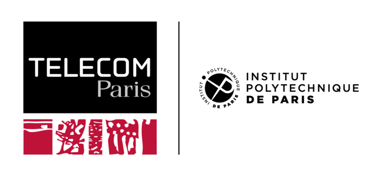
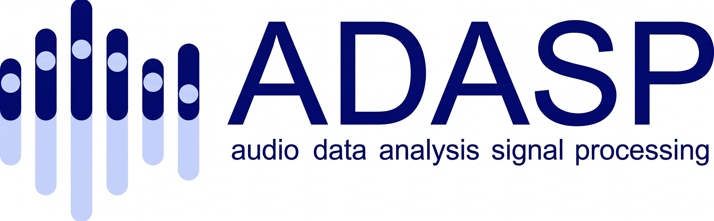
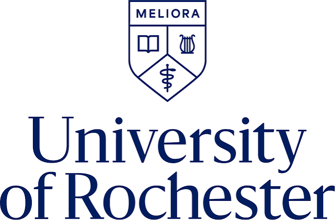
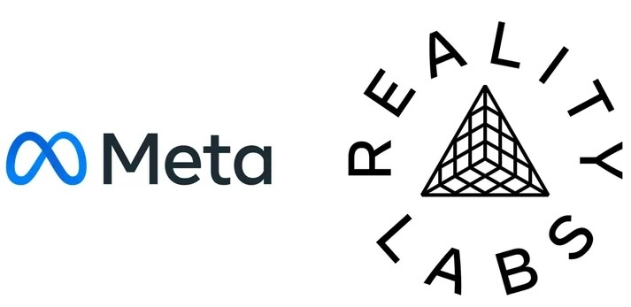
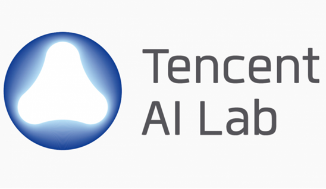
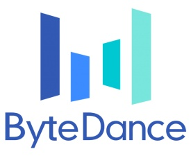
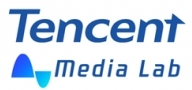
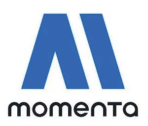

## Academic

<b> Télécom Paris, Institut Polytechnique de Paris </b> - <a href="https://adasp.telecom-paris.fr/index.html">Audio Data Analysis and Signal Processing (ADASP)</a> (Palaiseau, France)
<ul>
    <li>
        Assistant Professor (Nov 2026 - Present)
    </li>
</ul>

<b> University of Rochester </b> - <a href="https://labsites.rochester.edu/air/index.html">Audio Information Research Lab</a> (Rochester, NY, USA)
<ul>
    <li>
        PhD Student (Aug 2019 - Apr 2026)
    </li>
    <li>
        Audio Deepfake Detection; Personalized HRTF Modeling for Spatial Audio; Audio-Visual Generation and Analysis
    </li>
    <li>
        Committee: <a href="http://www2.ece.rochester.edu/~zduan/">Prof. Zhiyao Duan</a> (Advisor), <a href="https://www.hajim.rochester.edu/ece/people/faculty/cetin_mujdat/">Prof. Mujdat Cetin</a>, <a href="https://cliangxu.github.io/index.html">Prof. Chenliang Xu</a>
    </li>
</ul>

## Industrial

<b> Dolby Laboratories </b> - Multimodal Experiences Lab  (Atlanta, GA, USA)
<ul>
    <li>
        Senior Researcher (Jun 2025 - Oct 2026)
    </li>
    <li>
        Spatial Audio and Multimodal AI
    </li>
    <li>
        Manager: <a href="https://scholar.google.com/citations?user=EEds7hMAAAAJ">Dr. Lie Lu</a>
    </li>
</ul>

<b> Meta </b> - Meta Reality Labs  (Redmond, WA, USA)
<ul>
    <li>
        Research Intern (May 2024 - Sep 2024)
    </li>
    <li>
        Perceptual Head-Related Transfer Function (HRTF) Representation Learning
    </li>
    <li>
        Mentored by <a href="https://www.ishwarya.me/">Dr. Ishwarya Ananthabhotla</a>
    </li>
</ul>

<b> Microsoft </b> - Applied Sciences Group (Redmond, WA, USA)
<ul>
    <li>
        Research Intern (May 2023 - Aug 2023)
    </li>
    <li>
        Audio-Visual Segmentation by Prompting Segment Anything Model
    </li>
    <li>
        Mentored by <a href="https://www.microsoft.com/applied-sciences/people/kazuhito-koishida">Dr. Kazuhito Koishida</a>
    </li>
</ul>

<b> Tencent America </b> - Tencent AI Lab (Bellevue, WA, USA)
<ul>
    <li>
        Research Intern (May 2022 - Aug 2022)
    </li>
    <li>
        Multi-Channel Audio-visual Speaker Diarization
    </li>
    <li>
        Mentored by <a href="https://scholar.google.com/citations?user=4nGncN4AAAAJ">Dr. Shi-Xiong (Austin) Zhang</a>
    </li>
</ul>

<b> Bytedance / Tiktok </b> - Speech, Audio & Music Intelligence (Mountain View, CA, USA)
<ul>
<li>
    Research Intern (May 2021 - Aug 2021)
</li>
<li>
    Audio-visual Active Speaker Detection
</li>
<li>
Mentored by <a href="https://scholar.google.com/citations?user=5BusdUwAAAAJ">Dr. Ming Tu</a>
</li>
</ul>

<b> Tencent </b> - Tencent Media Lab (Shenzhen, Guangdong, China)
<ul>
    <li>
        Research Intern (Jun 2019 - Aug 2019)
    </li>
    <li>
        Perceptual Loss Design for Mask-based Speech Enhancement
    </li>
    <li>
Mentored by <a href="https://scholar.google.com/citations?user=NGejHPcAAAAJ">Dr. Yannan Wang</a>
</li>
</ul>

<b> Momenta </b> - Level4 Urban Autonomous Driving (Suzhou, Jiangsu, China)
<ul>
    <li>
        R&D Intern (Mar 2019 - Jun 2019)
    </li>
    <li>
        Vehicle Behavioral Prediction with Urban Vehicle Trajectory Data
    </li>
    <li>
Mentored by Sen Tian and <a href="https://scholar.google.com/citations?user=xrnhH-cAAAAJ">Dr. Jie Chen</a>
</li>
</ul>

## Services

### Special Sessions and Challenges Co-organized

* [Partially Edited Media: Perspectives from Synthesis and Defense](https://sites.google.com/view/partially-edited-media) Special Session, [IEEE International Conference on Acoustics, Speech, and Signal Processing (ICASSP)](https://2027.ieeeicassp.org/), Toronto, Canada, May 2027

* [Partially Edited Audio: Perspectives from Synthesis and Defense](https://sites.google.com/view/partially-edited-audio) Special Session, [IEEE Spoken Language Technology Workshop (SLT)](https://attend.ieee.org/slt-2026/), Palermo, Sicily, Italy, Dec 2026

* [Frontiers in Deepfake Voice Detection and Beyond](https://sites.google.com/view/deepfake-voice) Special Session, [IEEE Automatic Speech Recognition and Understanding Workshop (ASRU)](https://2025.ieeeasru.org/), Honolulu, HI, Dec 2025

* [Singing Voice Deepfake Detection (SVDD)](https://svddchallenge.org/) Challenge and Special Session, [IEEE Spoken Language Technology Workshop (SLT)](https://2024.ieeeslt.org/), Macao, China, Dec 2024

* [Singing Voice Deepfake Detection (SVDD) Task in MIREX](https://www.music-ir.org/mirex/wiki/2024:Singing_Voice_Deepfake_Detection) Challenge, [International Society for Music Information Retrieval (ISMIR) Conference](https://ismir2024.ismir.net/), San Francisco, CA, Nov 2024

### Reviewers

[Web of Science record](https://www.webofscience.com/wos/author/record/2320196)

**Journals**

* IEEE Transactions on Audio, Speech, and Language Processing (TASLP), 2023-2026

* IEEE Transactions on Multimedia (TMM), 2025-2026

* IEEE Transactions on Information Forensics and Security (TIFS), 2026

* IEEE Transactions on Pattern Analysis and Machine Intelligence (TPAMI), 2024

* IEEE Journal of Selected Topics in Signal Processing (JSTSP), 2024

* IEEE Signal Processing Letters, 2024-2026

* IEEE Open Journal of Signal Processing (OJSP), 2022-2026

* Transactions of the International Society for Music Information Retrieval (TISMIR), 2022-2026

* ACM Transactions on Multimedia Computing, Communications, and Applications (TOMM), 2024-2026

* EURASIP Journal on Information Security, 2025-2026

* EURASIP Journal on Audio, Speech, and Music Processing, 2024

* EURASIP Journal on Advances in Signal Processing, 2023-2025

* Computer Speech & Language, 2024

* ACM Computing Surveys, 2024

* Neural Networks, 2023-2025

* IEEE Access, 2023-2026

* IEEE Transactions on Computational Imaging (TCI), 2021

* International Journal of Electrical and Computer Engineering Systems (IJECES)

* Imaging Science Journal

**Peer-Reviewed Conferences and Workshops**

* IEEE International Conference on Acoustics, Speech and Signal Processing (ICASSP), 2024-2026

* ISCA Interspeech, 2023-2026

* IEEE Workshop on Applications of Signal Processing to Audio and Acoustics (WASPAA), 2025

* IEEE Spoken Language Technology Workshop (SLT), Meta-reviewer for SVDD special session, 2024

* IEEE Workshop on Automatic Speech Recognition and Understanding (ASRU), 2025

* ACM Multimedia, 2025

* Audio Engineering Society (AES) 152nd - 158th Convention, 2022-2025

* International Joint Conference on Neural Networks (IJCNN), 2025

* ISCA Automatic Speaker Verification and Spoofing Countermeasures (ASVspoof) Workshop, 2024

* ISCA Symposium on Security and Privacy in Speech Communication, 2024-2025

* CVPR Multimodal Learning and Applications Workshop (MULA), 2023-2025

* IJCAI Workshop on Deepfake Audio Detection and Analysis (DADA), 2023

### Co-chaired

* Western New York Virtual and Augmented Reality Mini-Conference [2022](https://www.rochester.edu/augmented-virtual-reality//news-events/conference/2022.html) & [2023](https://www.rochester.edu/augmented-virtual-reality//news-events/conference/2023.html)

### Volunteer

* IEEE ICASSP 2024 Student Volunteer

* Executive Committee Member for AR/VR PhD Training Program, 2023-2024

* Diversity, Equity, and Inclusion (DEI) Committee Member for ECE Department, 2022-2023

* [IEEEXtreme 16.0 Ambassador](https://certificate.ieeextreme.org/generate-email-certificate/ogK2pPNFGPGpSX4)

